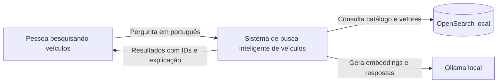
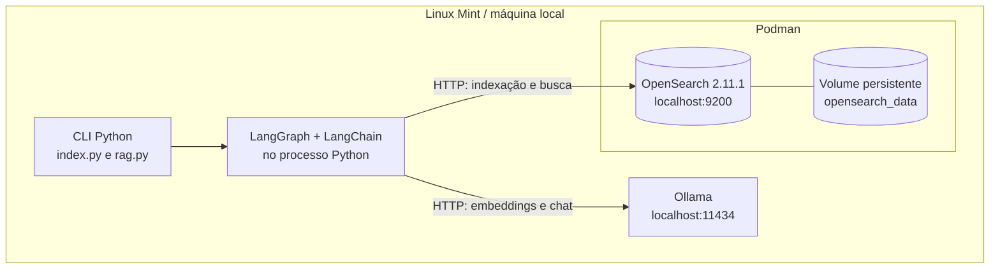
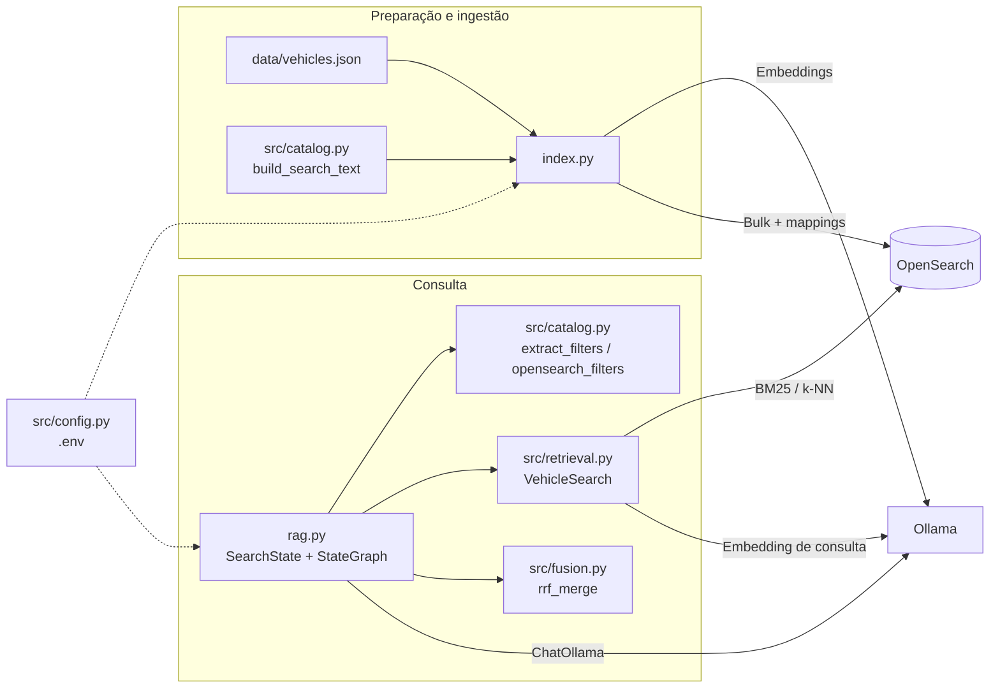
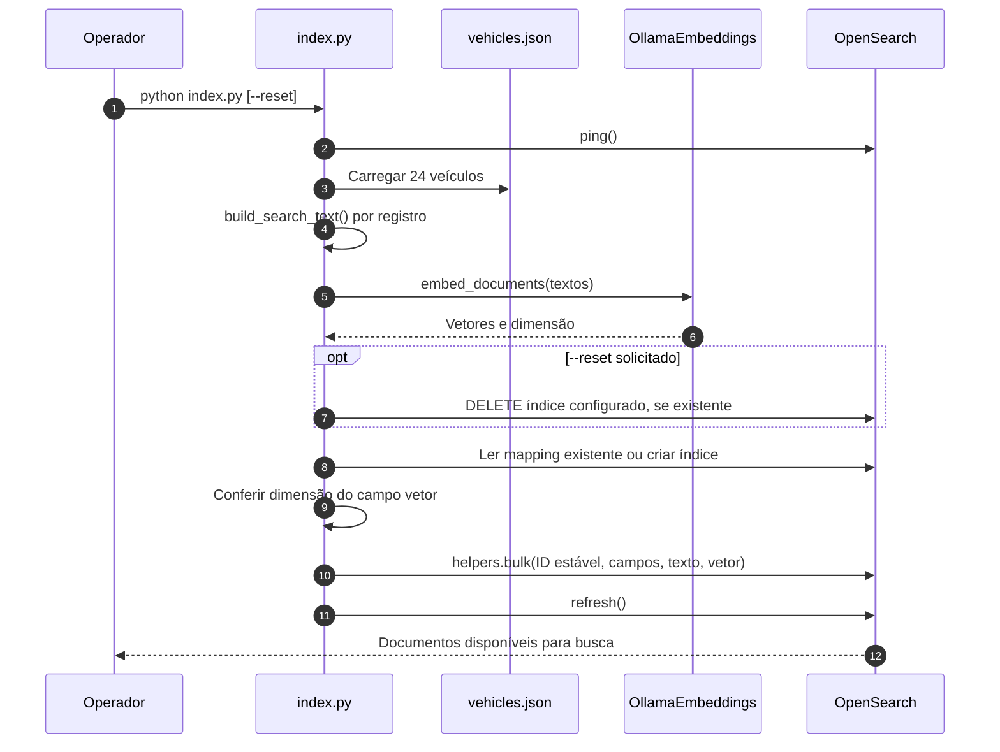
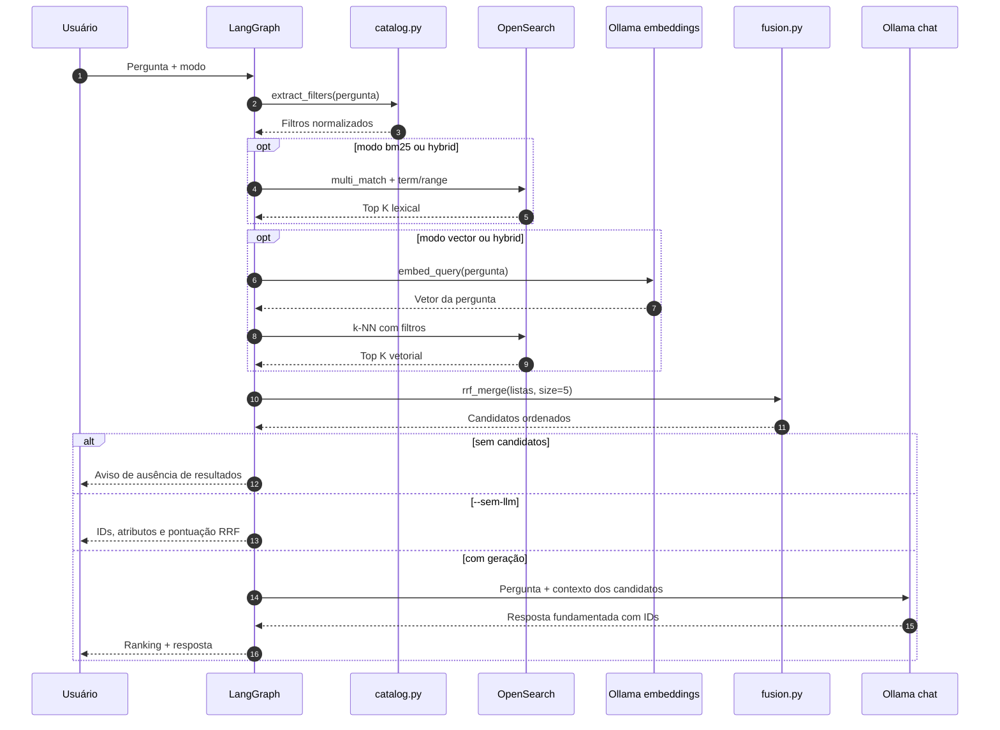

# Laboratório — Busca inteligente de veículos com LangChain, LangGraph, Ollama e OpenSearch

Laboratório Python **local**, orientado a estudo de arquitetura de soluções e RAG. O catálogo contém **24 veículos e preços inteiramente fictícios**, não corresponde a anúncios reais nem a preços de mercado. **Nenhuma GPU, PyTorch, Hugging Face ou token HF é necessário**.

## Escolha arquitetural

**Use BM25 + k-NN + filtros estruturados + RRF + RAG.** Em um catálogo de carros, buscar por nomes exatos, placa/código, versão e ano beneficia-se do índice invertido BM25; entender intenções como “carro confortável para uma família” beneficia-se de embeddings. Preço, câmbio, combustível, quilometragem e ano devem sempre usar filtros de campos, não similaridade. RRF combina posições dos dois rankings, não scores incompatíveis.

```text
Cliente (CLI Python)
     |
     v
LangGraph / StateGraph
     |
     +-- 1. interpretar_filtros (regex controlado, sem LLM)
     |
     +-- 2. buscar_bm25 --------> OpenSearch: índice invertido
     |
     +-- 3. buscar_vetorial ----> Ollama embeddings -> OpenSearch: Lucene HNSW k-NN
     |
     +-- 4. fusao_rrf ----------> Combinar rankings (RRF)
     |
     +-- 5. responder_rag ------> LangChain ChatOllama -> Qwen -> resposta com IDs
```

**OpenSearch:** `opensearchproject/opensearch:2.11.1`, índice `lab_veiculos_rag`, `texto_busca` do tipo `text` com analyzer `brazilian` para BM25 e `vetor` do tipo `knn_vector` usando Lucene/HNSW/cosine. Dimensão do vetor **inferida** do modelo de embeddings e validada na reindexação.

**Ollama:** `qwen2.5:1.5b` para respostas e `all-minilm` para embeddings (46 MB; opção econômica de laboratório). `all-minilm` não é uma opção otimizada para português; é escolhido por tamanho. Para melhor recuperação semântica em português, troque por `granite-embedding:278m` (multilíngue, 563 MB) e **reindexe com `--reset`**. Nunca misture vetores de modelos diferentes no mesmo índice.

**LangChain:** `OllamaEmbeddings`, `ChatOllama`, `ChatPromptTemplate`, `StrOutputParser`.

**LangGraph:** grafo de cinco nós, cada um lendo/escrevendo estado tipado. A execução atual é sequencial para facilitar depuração; em produção as buscas independentes poderiam rodar em paralelo após a extração dos filtros.

## Visão da solução e escopo

### Objetivo do produto

Permitir que um usuário descreva, em português, o veículo que procura e receba uma **lista auditável de candidatos**, seguida de uma resposta em linguagem natural **fundamentada exclusivamente no catálogo recuperado**. O exercício demonstra a divisão de responsabilidades entre busca lexical, busca semântica, regras determinísticas e geração por LLM.

| Requisito | Implementação atual | Critério de verificação |
|---|---|---|
| Consultar marca, modelo e versão | BM25 com reforço de campos | `--modo bm25 --sem-llm` |
| Buscar por intenção de uso | Embeddings do Ollama e OpenSearch k-NN | `--modo vector --sem-llm` |
| Combinar os dois sinais | Reciprocal Rank Fusion (RRF) no Python | `--modo hybrid --sem-llm` |
| Respeitar critérios objetivos | Regras de extração + filtros `term`/`range` no OpenSearch | Conferir filtros e atributos dos resultados |
| Responder usando evidências | Prompt com os 5 candidatos e IDs | Executar sem `--sem-llm` e conferir IDs |
| Repetir a carga do catálogo | IDs estáveis no `helpers.bulk` | Conferir `_count` após reindexar |

**Fora do escopo da versão atual:** API HTTP, interface web, autenticação, autorização por usuário, agentes com ferramentas dinâmicas, histórico de conversa, orquestração paralela, avaliação automatizada de relevância e integração com anúncios reais. O LangGraph implementa **um workflow determinístico**, não um agente autônomo.

## Arquitetura de referência — visão C4

Os diagramas abaixo representam **o código deste repositório**, não uma arquitetura de produção hipotética. São renderizados nativamente em visualizadores Markdown compatíveis com Mermaid, como o GitHub.

### C4 · Nível 1 — Contexto



O usuário interage por **CLI**. O OpenSearch armazena o catálogo e executa recuperação lexical/vetorial; o Ollama atende a geração de vetores e de texto. Não existe serviço remoto do Hugging Face no fluxo.

### C4 · Nível 2 — Contêineres de execução



- **Processo Python:** controla a jornada, interpreta filtros, emite consultas e monta o contexto do RAG.
- **OpenSearch:** um nó, um shard primário e nenhuma réplica; configurações dimensionadas para laboratório, não para alta disponibilidade.
- **Ollama:** hospeda dois modelos diferentes. O modelo de embeddings não gera resposta; o modelo de chat não é responsável por filtros de negócio.
- **Persistência:** apenas os documentos e vetores do OpenSearch são persistidos no volume. O `SearchState` do LangGraph existe em memória durante a execução.

### C4 · Nível 3 — Componentes Python



| Artefato | Responsabilidade efetivamente implementada |
|---|---|
| `data/vehicles.json` | Fonte de 24 registros fictícios |
| `index.py` | Gerar texto pesquisável, criar/validar mapping, calcular embeddings, executar bulk e refresh |
| `rag.py` | Definir estado, montar os cinco nós do grafo, aplicar prompt e exibir resposta |
| `src/catalog.py` | Normalizar texto, extrair filtros por regex, criar cláusulas OpenSearch e texto para embeddings |
| `src/retrieval.py` | Abrir conexão e executar consultas BM25 ou k-NN, excluindo vetor do resultado apresentado |
| `src/fusion.py` | Agregar rankings por RRF e limitar aos cinco candidatos finais |
| `src/config.py` | Ler variáveis de ambiente e defaults de modelos, índice e `TOP_K` |
| `tests/` | Validar extração de filtros e fusão RRF, sem dependências de serviços externos |

## Fluxos de dados e contratos

### Fluxo A — Indexação do catálogo



**Invariantes:** a dimensão dos vetores deve corresponder ao mapping; reexecutar a carga com os mesmos IDs atualiza os documentos; `--reset` exclui o índice configurado antes de recriá-lo. A aplicação verifica a **dimensão**, mas não registra no índice o nome ou a versão do modelo: se você trocar o modelo por outro com a mesma dimensão, faça **reindexação explícita** mesmo assim.

### Fluxo B — Consulta híbrida e geração RAG



### Estado do LangGraph e execução

O grafo segue a sequência **`START → interpretar_filtros → buscar_bm25 → buscar_vetorial → fusao_rrf → responder_rag → END`**. Os nós existem nos três modos, mas um deles devolve lista vazia quando não é utilizado.

| Chave do `SearchState` | Tipo | Produzida ou consumida por |
|---|---|---|
| `pergunta` | `str` | Entrada do CLI; usada em interpretação, busca e resposta |
| `modo` | `str` | Entrada: `bm25`, `vector` ou `hybrid` |
| `sem_llm` | `bool` | Entrada: desliga somente a geração final |
| `filtros` | `dict` | Produzido em `interpretar_filtros` |
| `resultados_bm25` | `list[dict]` | Produzido em `buscar_bm25` |
| `resultados_vetoriais` | `list[dict]` | Produzido em `buscar_vetorial` |
| `candidatos` | `list[dict]` | Produzido em `fusao_rrf` (até 5) |
| `resposta` | `str` | Produzido em `responder_rag` |

**Importante:** `--sem-llm` **não elimina a geração do embedding da pergunta** nos modos `vector` e `hybrid`; ele apenas evita `ChatOllama` no nó final. A instância do cliente de chat ainda é criada, mas a chamada de inferência não acontece.

### Modelo do documento e estratégia de índices

| Campo | Tipo OpenSearch | Uso principal |
|---|---|---|
| `_id` / `id` | ID do documento e campo do JSON | Deduplicação na fusão e referência na resposta |
| `marca` | `text` + subcampo `marca.raw` (`keyword`) | Ranking por BM25 e filtro exato por marca |
| `modelo`, `versao` | `text` | Busca lexical com boost |
| `ano`, `preco`, `km` | `integer` | Filtros `range` |
| `carroceria`, `cambio`, `combustivel` | `keyword` | Filtros exatos `term` |
| `destaques`, `descricao` | `text` | Evidência textual no contexto do RAG |
| `texto_busca` | `text` / analyzer `brazilian` | Texto agregado para BM25 |
| `vetor` | `knn_vector` / Lucene HNSW / similaridade cosseno | Busca aproximada por similaridade semântica |

**Consulta lexical:** `multi_match` em `marca^3`, `modelo^4`, `versao^2`, `texto_busca^2`, junto aos filtros extraídos. **Consulta vetorial:** o mesmo conjunto de filtros estruturados acompanha a busca k-NN. Os vetores são omitidos do `_source` dos resultados retornados para evitar transportar dados que não serão exibidos ao usuário.

**Política de filtros:** o parser atual reconhece carroceria, câmbio, combustível, marca, alguns limites de preço, ano mínimo e quilometragem máxima. Não há compreensão geral de linguagem natural: termos não cobertos por regex permanecem apenas no texto da consulta. Como preço e ano são requisitos críticos, valide a lista final antes de confiar em qualquer recomendação.

### Fusão de rankings — Reciprocal Rank Fusion

A função `rrf_merge` considera até `TOP_K=8` resultados de cada mecanismo, ordenados pela posição em sua respectiva lista, e devolve até cinco documentos. Para cada veículo `d`:

\[
\operatorname{RRF}(d)=\sum_{r\in\{BM25,\,kNN\}\text{ onde }d\text{ aparece}}\frac{1}{60+\operatorname{pos}_r(d)}
\]

O valor `60` é a constante padrão definida em `src/fusion.py`. Um mesmo veículo presente nas duas listas recebe contribuições de ambas. **Não** é feita soma direta dos `_score` lexicais com scores de similaridade, pois são escalas diferentes. Em modo `bm25` ou `vector`, a função continua aplicando RRF sobre uma única lista não vazia.

### Grounding e limites de confiança

O contexto encaminhado ao `ChatOllama` contém **somente os cinco candidatos finais**, com `ID`, marca, modelo, versão, ano, preço, quilometragem, carroceria, câmbio, combustível, destaques e descrição. O prompt pede para citar IDs, não inventar fatos e ignorar instruções embutidas nos dados. Essa orientação é uma **medida básica**, não uma defesa completa contra prompt injection. O LLM **não escreve consultas OpenSearch**, não altera documentos e não determina sozinho os filtros exatos.

## Decisões arquiteturais (ADRs resumidos)

| ADR | Decisão | Motivação | Trade-off |
|---|---|---|---|
| ADR-001 | BM25 e vetor no mesmo OpenSearch | Evitar duas bases de busca; demonstrar recuperação híbrida | Mais recursos e complexidade de indexação que BM25 isolado |
| ADR-002 | Filtros de negócio determinísticos | Aplicar limites verificáveis de preço, ano e atributos | Regex cobre somente padrões conhecidos; necessita evolução |
| ADR-003 | RRF em Python | Tornar a fusão transparente e inspecionável | Faz duas consultas e traz resultados à aplicação |
| ADR-004 | Ollama local com dois modelos | Privacidade e baixo custo de laboratório, sem API externa | Latência e qualidade dependem da CPU/RAM e do modelo escolhido |
| ADR-005 | Workflow LangGraph sequencial | Facilitar depuração e entendimento do estado | Maior latência em busca híbrida que execução paralela |
| ADR-006 | Índice único e dados fictícios | Reprodutibilidade e simplicidade | Não demonstra escala, atualização de anúncios nem governança real |

**Possíveis evoluções para um case corporativo:** ingestão por eventos/outbox, índice versionado com alias e migração sem indisponibilidade; controle de acesso por tenant; circuit breaker, retries com backoff e limites de tempo; observabilidade com trace por nó e métricas p50/p95/p99; testes de relevância com conjunto de perguntas rotuladas e rollout A/B de estratégias de busca.

## Pré-requisitos

- Linux Mint, Python 3.11+ e `podman` + `podman-compose` (ou Docker Compose v2, se disponível). No Mint observado, `podman compose` escolhia o `docker-compose` legado e falhava com Python 3.12.
- Ollama instalado e serviço `http://localhost:11434` disponível.
- Espaço suficiente em disco e memória (recomenda-se **8 GB RAM ou mais** no host para executar OpenSearch + LLM com folga; verifique com `free -h` e `df -h /`).
- OpenSearch com segurança **desabilitada apenas para este laboratório local**; a porta 9200 é vinculada a `127.0.0.1`. Nunca exponha o serviço à internet.

> O aviso `HF_TOKEN` e os erros anteriores de `filelock`/PyTorch não são relevantes aqui: usamos embeddings diretamente no Ollama, sem carregar `sentence-transformers`.

## 1. Iniciar o OpenSearch

Na pasta do projeto, **antes da primeira execução**, altere **somente a referência da imagem** em `compose.yaml` para usar o registry completo (o Podman rootless do laboratório não resolveu o nome curto):

```yaml
services:
  opensearch:
    image: docker.io/opensearchproject/opensearch:2.11.1
```

A alteração acima é apenas na linha `image:`; **preserve as demais configurações do seu `compose.yaml`**. Em seguida:

```bash
podman-compose up -d
podman ps
curl http://localhost:9200
curl 'http://localhost:9200/_cluster/health?pretty'
```

**Por que `podman-compose` com hífen?** Nesta instalação, `podman compose` tenta executar `/usr/bin/docker-compose` **1.29.2**, incompatível com o Python 3.12 por depender de `distutils`. O `podman-compose` **1.0.6** já está disponível. Evite `sudo podman-compose`, pois o projeto deve rodar no contexto rootless do usuário. Se quiser manter o comando com espaço, configure `PODMAN_COMPOSE_PROVIDER` para apontar a `podman-compose` antes da execução.

Se já tem um OpenSearch disponível, **não precisa iniciar outro**: ajuste `OPENSEARCH_URL` no `.env`. Não use cluster corporativo; teste somente em laboratório. O índice criado usa nome separado: `lab_veiculos_rag`.

Caso o OpenSearch não suba, observe `podman-compose logs opensearch`, `free -h` e `df -h /`. Em ambientes Linux, algumas instalações podem exigir `vm.max_map_count=262144` (apenas após confirmar esse erro nos logs).

## 2. Preparar Ollama

```bash
ollama --version
ollama list
curl http://localhost:11434/api/tags
ollama pull qwen2.5:1.5b
ollama pull all-minilm
```

Se o Ollama já estiver ativo via `systemd`, **não execute `ollama serve` outra vez**. Se necessário: `sudo systemctl start ollama`.

Para embeddings com suporte explícito a português, opcionalmente:

```bash
ollama pull granite-embedding:278m
# Altere OLLAMA_EMBED_MODEL=granite-embedding:278m no .env,
# depois execute python index.py --reset para recriar vetores e mappings.
```

## 3. Criar ambiente Python isolado

```bash
cd vehicle-search-rag
python3 -m venv .venv
source .venv/bin/activate
python -m pip install --upgrade pip
python -m pip install -r requirements.txt
cp .env.example .env
```

Este laboratório é independente do `lab_rag` anterior. Não instala PyTorch nem as dependências CUDA daquele projeto. Não execute `sudo pip install`.

## 4. Popular OpenSearch

```bash
python index.py
```

Vai gerar embeddings do catálogo no **Ollama local**, criar índice com BM25 + HNSW e importar 24 documentos. Repetir `python index.py` atualiza os mesmos IDs. `--reset` apaga **somente o índice `OPENSEARCH_INDEX` configurado** e recria o mapping; use apenas quando quiser deliberadamente reconstruir esse índice.

Conferir:

```bash
curl 'http://localhost:9200/lab_veiculos_rag/_count?pretty'
curl 'http://localhost:9200/lab_veiculos_rag/_mapping?pretty'
```

## 5. Comparar os três tipos de busca

```bash
# Índice invertido BM25 (sem chamar o modelo de geração)
python rag.py --modo bm25 --sem-llm --pergunta 'Fiat Pulse 2023'

# Semântica (embeddings Ollama + OpenSearch k-NN)
python rag.py --modo vector --sem-llm --pergunta 'Carro confortável para viajar com crianças e bagagem'

# Combinação de ranks por RRF
python rag.py --modo hybrid --sem-llm --pergunta 'SUV automático até 100 mil'
```

Em `--sem-llm` o LangGraph percorre os nós, mas não chama o modelo de geração. Com isto, é possível estudar a recuperação separadamente da qualidade do texto final.

## 6. Executar RAG completo

```bash
python rag.py --modo hybrid --pergunta 'Quero um SUV automático de até R$ 100 mil para viajar com minha família'

python rag.py --modo hybrid --pergunta 'Quais modelos Toyota a partir de 2021 custam até R$ 120 mil?'

python rag.py --modo hybrid --pergunta 'Qual picape diesel acima de R$ 80 mil e até R$ 150 mil serve para trabalho rural?'
```

O programa exibe: **modo, filtros extraídos, top 5 veículos recuperados com IDs, pontuação RRF e resposta gerada com referências a IDs**. O prompt impede conscientemente uso de informações fora do contexto, mas modelos pequenos ainda podem errar; valide os fatos contra a lista impressa.

## 7. Rodar testes unitários

```bash
python -m pytest -q
```

Testes cobrem parsing de filtros (preço, ano, combustível, KM) e fusão RRF, sem serviços externos.

## Exemplos do que comparar

| Consulta | BM25 | Vetorial | Híbrida |
|---|---|---|---|
| `Fiat Pulse 2023` | Referência exata | Conceito próximo | Deve conservar correspondência literal |
| `carro espaçoso para viajar com crianças` | Palavras isoladas | Semântica | Intenção + texto |
| `SUV automático até 100 mil` | Termos + filtros | Conceito + filtros | Ambos + filtros rígidos |
| `picape diesel para sítio` | Vocabulário do catálogo | Significado de uso | Combinação |

**Como medir:** relevance@5/precision@5, recall@5 e tempo p50/p95 para cada estratégia; gere gabarito manual de IDs por consulta. Os resultados não são garantidos: dependem do embedding, corpus e condições de execução.

## Limitações e evoluções

1. **Filtro simples por regras:** `extract_filters` cobre algumas expressões em português, mas não é um parser geral; pedidos complexos podem precisar de extração estruturada por LLM + validação Pydantic ou filtros explícitos de UI. O filtro de preço/ano não deve ser inferido apenas por semântica.
2. **RRF na aplicação:** neste laboratório a fusão acontece em Python para ser visível; OpenSearch 2.11 também permite hybrid query + search pipeline com normalização. A pesquisa nativa com RRF exige verificar suporte da versão do cluster (não assumir que a funcionalidade mais recente existe em 2.11).
3. **Catálogo pequeno:** k-NN não representa medições de produção; 24 documentos servem para aprender. Produção exige carga real, relevância, atualização e observabilidade.
4. **Sem disponibilidade real:** preços, anúncios e dados são inventados. Para um produto real, integre sua fonte de dados autorizada, remova PII e respeite contratos.
5. **Segurança:** autenticação do OpenSearch, escopo de acesso por usuário/tenant, anti-prompt-injection, rate limits, logs e autorização de consultas são obrigatórios em produção. Não exiba campos que o usuário não poderia acessar.
6. **Atualização:** em produção, versionar índice + alias, ingestão assíncrona, reindexação gradual e checks de compatibilidade do modelo são caminhos naturais.

## Operação e troubleshooting — Linux Mint + Podman

| Sintoma | Diagnóstico provável | Ação recomendada |
|---|---|---|
| `ModuleNotFoundError: No module named 'distutils'` | `podman compose` escolheu Docker Compose 1.x, incompatível com Python 3.12 | Execute `podman-compose up -d` com hífen |
| `short-name ... did not resolve to an alias` | `image:` sem registry e nenhuma regra de resolução do Podman | Use `docker.io/opensearchproject/opensearch:2.11.1` no `compose.yaml` |
| `no such container` após erro de imagem | Container nunca chegou a ser criado | Corrija o erro de pull; depois suba novamente |
| `curl: (7) Failed to connect` na porta 9200 | Container parado, iniciando ou encerrando por erro | Rode `podman ps -a` e `podman logs rag-vehicles-opensearch` |
| OpenSearch encerrando por memória | Limite de RAM/swap do host ou configuração do kernel | Verifique `free -h`, `podman logs` e limites do sistema |
| `vm.max_map_count` insuficiente nos logs | Configuração de memória virtual do kernel | Ajuste conforme a exigência específica mostrada nos logs |
| `No space left on device` | Espaço esgotado por imagens, volumes ou cache | Inspecione `df -h /`, `podman system df` e o cache do pip antes de limpar |
| `ollama: command not found` | Ollama não instalado ou indisponível no PATH | Verifique `command -v ollama` e instalação |
| `connection refused` em `11434` | Serviço Ollama não iniciado | Rode `systemctl status ollama` ou o método de inicialização local usado |
| Erro de dimensão do vetor | Dimensão do índice diferente do modelo configurado | Confira `.env`; somente para este índice de laboratório, use `python index.py --reset` quando for reindexar |
| Contagem do índice menor que 24 | Indexação incompleta, exceção de bulk ou índice incorreto | Reexecute `python index.py` e confira `OPENSEARCH_INDEX` |

### Checklist de diagnóstico (sem apagar dados)

```bash
podman-compose --version
podman ps -a
podman logs --tail 100 rag-vehicles-opensearch
curl -s http://localhost:9200/_cluster/health?pretty
curl -s http://localhost:9200/lab_veiculos_rag/_count?pretty
ollama list
curl -s http://localhost:11434/api/tags
free -h
df -h /
```

O resultado `green` ou `yellow` do health depende também de shards e réplicas; neste laboratório o índice declara **zero réplicas**. O essencial é que o serviço esteja acessível e a operação de indexação/busca esteja íntegra. O comando `podman-compose down` remove containers e rede do projeto, **não o volume persistente**; já `down -v` removeria volumes associados.

## Critérios de aceite e roteiro de demonstração

1. **Infraestrutura:** OpenSearch responde em `localhost:9200` e Ollama responde em `localhost:11434`.
2. **Catálogo:** `python index.py` termina sem erro; `_count` mostra **24** documentos no índice configurado.
3. **Busca lexical:** uma consulta exata de modelo retorna IDs auditáveis no modo `bm25`.
4. **Busca vetorial:** uma descrição de intenção retorna candidatos no modo `vector` e gera o vetor localmente.
5. **Busca híbrida:** a mesma consulta no modo `hybrid` exibe candidatos e `rrf_score`.
6. **Filtro de negócio:** as características e os valores dos candidatos retornados atendem aos filtros extraídos e impressos.
7. **Geração:** a resposta RAG menciona IDs que estão efetivamente entre os candidatos apresentados; se não houver candidatos, comunica a ausência sem criar veículos fictícios adicionais.
8. **Qualidade interna:** `python -m pytest -q` executa testes de parser e RRF.

A validação integral desses critérios **exige executar o projeto com OpenSearch e Ollama disponíveis na máquina local**. O código de testes automatizados atual não cobre integração, robustez nem desempenho do serviço completo.

## Encerrar

```bash
podman-compose down
```

Não use `down -v` se quiser preservar o volume do OpenSearch. Não use `podman system prune` sem verificar outros contêineres/imagens importantes.

## Fontes técnicas

- [OpenSearch — hybrid search](https://docs.opensearch.org/latest/vector-search/ai-search/hybrid-search/)
- [OpenSearch — filtro k-NN](https://docs.opensearch.org/latest/vector-search/filter-search-knn/index/)
- [OpenSearch — knn_vector](https://docs.opensearch.org/latest/mappings/supported-field-types/knn-vector/)
- [LangGraph StateGraph](https://reference.langchain.com/python/langgraph/graph/state/StateGraph)
- [LangChain OllamaEmbeddings e ChatOllama](https://reference.langchain.com/python/langchain-ollama)
- [Ollama all-minilm](https://ollama.com/library/all-minilm)
- [Ollama granite-embedding](https://ollama.com/library/granite-embedding)
